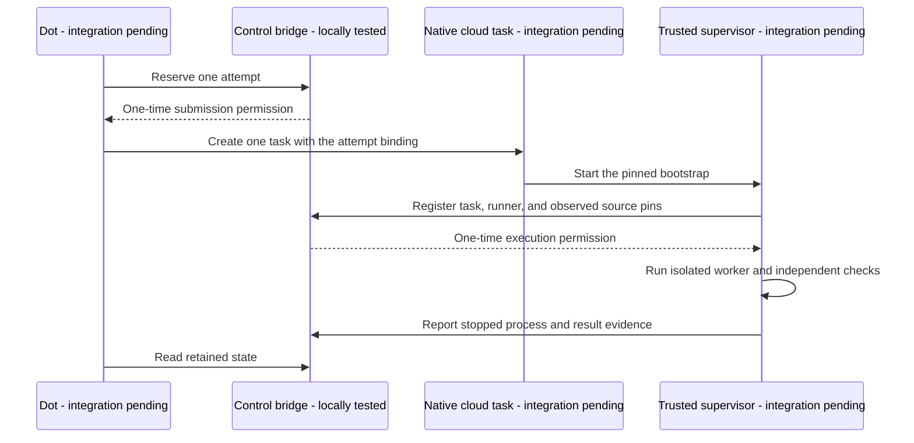

# Operate the pilot control bridge

The control bridge stores attempt ownership and budgets for the Sweatshop pilot.
It provides an HTTP API, a command-line client, and a local recovery test.
It does not yet connect native dot tasks to the coding worker or publisher.

## Current capability

The local test uses real HTTP requests and a persistent SQLite database.
Its task IDs, source revisions, and worker reports are synthetic.
It does not prove cloud access, native task identity, process termination, or pull request delivery.

The following arrows show the proposed live handoff.
Only the API and record transitions have local tests.



## Run the local recovery test

Use Node.js 26 or later.
Run this command from the repository root:

```sh
npm run smoke:control
```

The test requires loopback network access.
It creates a private temporary directory and prints the path to `evidence.json`.
It retains the SQLite database for inspection and stops its HTTP server before exit.
It does not contact GitHub, create native tasks, or run a coding worker.

The test covers uncertain submission, service restart, repeated registration, duplicate runners, obsolete results, and the shared attempt limit.
The unit suite also covers concurrent database connections and dropped HTTP responses.

## Configure one authority

Use one authoritative service and one persistent database for the pilot.
Keep the database outside both the controller and candidate checkouts.
Do not use an ephemeral cloud task filesystem as the only copy.
Do not start separate cloud and local databases for the same goal.
Separate databases cannot enforce a shared attempt limit.

Remote callers require an HTTPS endpoint with a trusted certificate.
The service itself supplies loopback HTTP for a reverse proxy.
Hosting, HTTPS termination, persistent storage, and access from the dot remain deployment prerequisites.
No hosted endpoint is supplied by this repository.

Create a service configuration outside the candidate checkout:

```json
{
  "databasePath": "/absolute/private/runtime/control.sqlite",
  "host": "127.0.0.1",
  "port": 8787,
  "contracts": [
    {
      "projectId": "sweatshop",
      "contractId": "status-read-only-v1",
      "baselineSha": "REPLACE_WITH_FULL_BASELINE_COMMIT",
      "controllerSha": "REPLACE_WITH_FULL_BOOTSTRAP_COMMIT",
      "acceptanceSha": "REPLACE_WITH_ACCEPTANCE_FILE_SHA256",
      "allowedFiles": ["src/cli.mjs", "src/cli.test.mjs"],
      "maxAttempts": 2,
      "maxDurationMs": 1800000
    }
  ],
  "credentials": [
    {"projectId": "sweatshop", "role": "coordinator", "tokenEnv": "SWEATSHOP_COORDINATOR_TOKEN"},
    {"projectId": "sweatshop", "role": "supervisor", "tokenEnv": "SWEATSHOP_SUPERVISOR_TOKEN"}
  ]
}
```

The placeholders deliberately fail validation.
Use a separate contract and database for a harmless integration probe.
Do not spend the product goal's attempts on setup tests.

Supply separate random credentials through the host's secret controls.
Each credential must contain at least 32 characters without whitespace.
The coordinator can reserve attempts and mark uncertain submissions.
The supervisor can register a runner and report its result.
Both can read their project's state.
Neither API role can change contracts, reset budgets, or publish a pull request.
Keep both credentials out of worker environments and logs.

Start the service with the configuration path:

```sh
node src/control-api.mjs --config /absolute/private/control.json
```

The service refuses changed contract values when the database already contains that project.
The first accepted registration starts the scheduling clock.
The deadline prevents new admissions.
It does not discard later results from previously admitted work.
Worker termination remains the trusted supervisor's responsibility.

## Use the command client

Set `SWEATSHOP_CONTROL_URL`, `SWEATSHOP_PROJECT`, and `SWEATSHOP_CONTROL_TOKEN` through the caller's environment.
Use the credential for that caller's role.

Read the bridge state:

```sh
node src/control-command.mjs status
```

This reads the bridge database through HTTP.
It does not invoke the existing stateful `src/cli.mjs status` command.

For a mutation, supply one JSON document through a file or a pipe that closes its input:

```sh
node src/control-command.mjs reserve < reservation.json
```

| Command | Required JSON fields |
| --- | --- |
| `reserve` | `contractId`, unique retained `operationId`, `executor` set to `cloud` or `local` |
| `unknown` | `contractId`, `attemptId`, `generation` |
| `register` | Attempt binding plus `nativeTaskId`, fresh process-specific `runnerId`, and `observed` |
| `finish` | Attempt binding plus `nativeTaskId`, `runnerId`, `outcome`, `stopped`, and `evidence` |

The attempt binding consists of `contractId`, `attemptId`, and `generation` from the reservation response.
`observed` contains `baselineSha`, `controllerSha`, `acceptanceSha`, and `allowedFiles` matching the frozen contract.
The supervisor must inspect its actual files before sending those values.
`evidence` contains those same fields, a full `candidateSha`, and the relevant result details.
`outcome` is `complete` or `failed`.
Set `stopped` to `true` only after the supervisor establishes that the associated worker has stopped.

Exit code 0 means the request returned successfully, not that new work is permitted.
Create a native task only from a fresh reservation response with `maySubmit: true`.
Start a worker only from a fresh registration response with `mayExecute: true`.
Repeated responses and status reads never grant fresh execution permission.
Do not save either permission as a reusable instruction.

Exit code 1 reports a rejected request or invalid input.
Exit code 2 reports an uncertain mutation outcome.
The client does not retry requests automatically or follow redirects.
Retain request identifiers before submission so a lost response can be investigated.
If native task creation is uncertain, mark the attempt `unknown` and stop new submissions.
If registration is uncertain, stop that runner without starting a worker.
Read the retained state and inspect the native task before any recovery action.
There is no automatic lease expiry, reset, or takeover route.

## Remaining integration checks

The service trusts supervisor reports about task identity, source files, and stopped processes.
It cannot attest a native task ID or prevent a caller from bypassing the protocol.
The first valid registration wins.
This alone does not prove that the intended native task won.
The integrated bootstrap must establish these boundaries before the product trial starts.

A bridge attempt marked `complete` is an executor report.
It does not mean that independent checks passed or a pull request exists.
The existing publisher and its exact-head readback remain separate from this API.
Do not call the old factory `tick` directly as a cloud integration shortcut.
Its local attempt records do not consume this bridge's shared budget.

Next, check the cloud environment, choose the persistent service host, and test a native no-op handoff.
Record the environment ID, actual source revision, tool versions, repository permissions, and sandbox results.
Then connect the trusted worker and publisher, freeze the pilot manifest, and run the accepted status goal.
Keep a decision log current as each boundary is tested.
